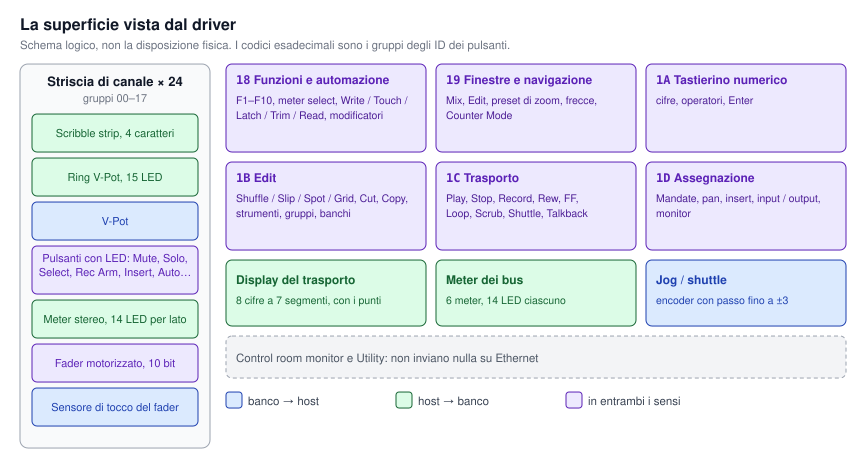
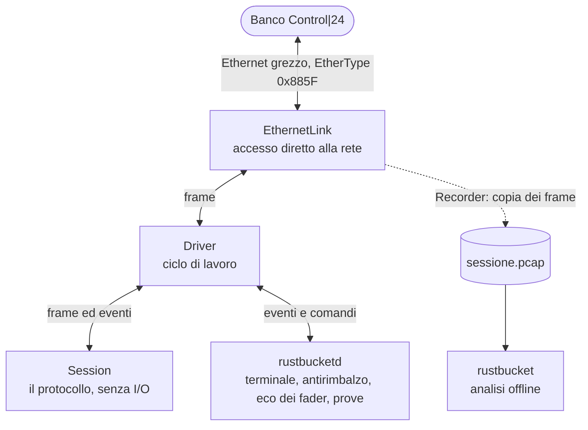
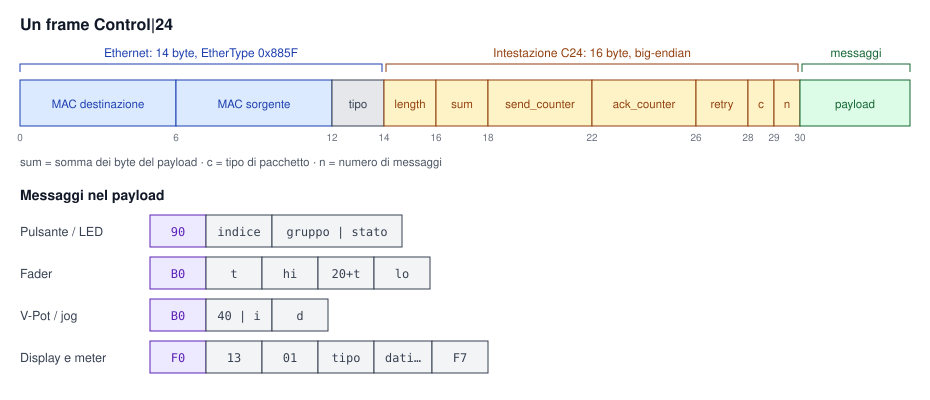
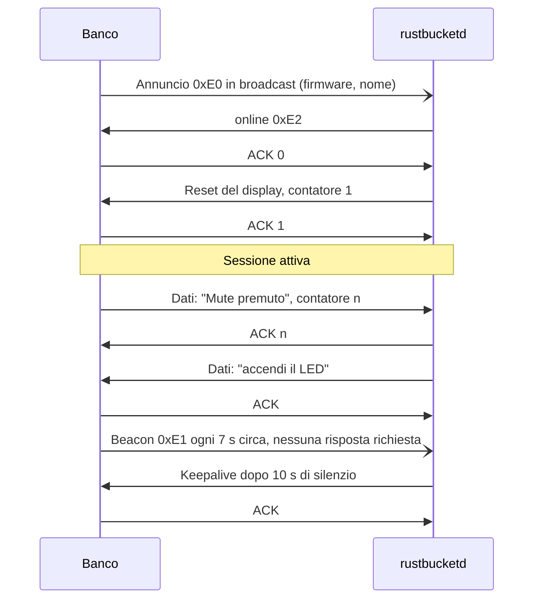
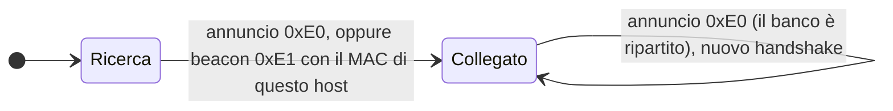

# Rustbucket

Driver indipendente e open source, scritto in Rust, per la superficie di controllo
**Digidesign Control|24**. Parla direttamente con il banco via Ethernet, senza
Pro Tools né altro software di terze parti.

**Stato:** il driver legge e comanda tutta la superficie, ed è stato provato su un
banco reale (firmware `v1.08`) da macOS. **Non si collega ancora a una DAW:** per ora
mostra nel terminale cosa succede sul banco e offre alcune prove delle luci e dei motori.

## Cosa può fare

| Elemento | Dal banco | Verso il banco |
|---|---|---|
| Pulsanti (ognuno con il suo nome) | pressione e rilascio, senza rimbalzi | LED acceso o spento |
| Fader motorizzati (24) | posizione a 10 bit, tocco | movimento del motore |
| V-Pot (24) e jog | rotazione con segno | ring di 15 LED |
| Scribble strip (24) | | 4 caratteri ASCII |
| Meter (24 stereo + 6 bus) | | 14 LED ciascuno, anche a partire da un livello in dB |
| Display del trasporto | | 8 cifre a 7 segmenti, con testo e punti |



Inoltre:

- **Registra** il traffico del banco in un file `.pcap`, apribile anche con Wireshark.
- **Analizza** le registrazioni e segnala ciò che contraddice la specifica.
- **Gestisce la sessione da solo:** trova il banco, si ricollega se viene riacceso,
  conferma i pacchetti e mantiene viva la connessione.

## Come è fatto

Il progetto è una libreria con due programmi. La parte centrale, `Session`, non
tocca né la rete né l'orologio: riceve frame e orari e risponde con i frame da
inviare e gli eventi da segnalare. Per questo si può provare per intero con un
banco simulato.



| Modulo | Compito |
|---|---|
| `frame`, `header`, `announce`, `mac` | Frame Ethernet, intestazione, checksum, annunci del banco |
| `message` | Messaggi nei due sensi, ring, meter, font a 7 segmenti |
| `buttons` | Nomi di tutti i pulsanti |
| `session` | Macchina a stati del protocollo, senza I/O |
| `driver` | Collega una `Session` a un qualsiasi `Link` di rete |
| `debounce` | Filtro dei rimbalzi dei pulsanti |
| `pcap`, `analysis` | Registrazione e verifica del traffico |

## Come funziona il protocollo

La specifica completa, con la provenienza di ogni dato, è in [PROTOCOL.md](PROTOCOL.md).

### Il frame

Il banco non usa IP: scambia frame Ethernet grezzi, quindi serve l'accesso diretto
alla scheda di rete.



### La connessione



L'host invia un pacchetto alla volta e aspetta il suo ACK. I messaggi accumulati nel
frattempo partono insieme nel pacchetto successivo.



### Particolarità del banco

- **Checksum:** due byte dell'intestazione contengono la somma dei byte del payload.
- **Pulsanti che rimbalzano:** i contatti consumati trasformano spesso una pressione in
  due. Il rimbalzo dura al massimo 47 ms, quindi il driver scarta una nuova pressione
  entro 60 ms dal rilascio dello stesso tasto.
- **Fader che tornano indietro:** rilasciato, il motore riporta il fader all'ultima
  posizione impostata dall'host. Il driver rimanda quindi ogni posizione ricevuta, e il
  fader resta dove lo lasci.
- **Ritrasmissioni:** senza ACK, il banco ripete il pacchetto ogni 31 ms circa per 16
  volte, poi rinuncia e il messaggio è perso.
- **Meter e display:** non ricevono valori, ma maschere di bit in cui ogni bit accende
  un singolo LED o segmento.

## Uso

Serve [Rust](https://rustup.rs) (edizione 2024) e un collegamento Ethernet con il banco,
anche tramite adattatore.

```bash
cargo build --release
```

Per trovare il nome dell'interfaccia:

```bash
networksetup -listallhardwareports
```

L'accesso diretto alla rete richiede `sudo`. Negli esempi l'interfaccia è `en7`:

```bash
sudo ./target/release/rustbucketd en7
```

Se il programma non riesce a leggere il MAC dell'interfaccia, ricavalo con
`ifconfig en7 | grep ether` e passalo con `--mac aa:bb:cc:dd:ee:ff`.

### Prove

Si aggiunge un'opzione alla volta al comando:

| Opzione | Cosa succede |
|---|---|
| `--demo` | Nomi sui display e testo sul trasporto. I pulsanti accendono il loro LED, i V-Pot muovono ring e valore |
| `--wave-test` | Un'onda attraversa i 24 canali e muove insieme fader, ring, meter e LED Select |
| `--ring-test` | Accende uno alla volta i LED dei ring |
| `--meter-test` | Accende uno alla volta i LED dei meter, poi il lato destro e i bus |
| `--clock-test` | Accende una alla volta cifre, segmenti e punti del display del trasporto |

Le ultime tre avanzano con Invio, e `b` + Invio torna indietro. Si esce con Ctrl+C:
luci e fader restano come sono.

### Registrare e analizzare

```bash
sudo ./target/release/rustbucketd en7 --record sessione.pcap
```

```bash
./target/release/rustbucket sessione.pcap --summary
```

Senza `--summary` il programma elenca anche ogni pacchetto. Viene salvato solo il
traffico Control|24, ma il file contiene il MAC dell'host: tienilo presente prima di
condividerlo.

### Sviluppo

I test non richiedono il banco:

```bash
cargo test
```

## Limiti attuali

- Nessun collegamento a una DAW: è il prossimo passo.
- Provato solo su macOS e con il firmware `v1.08`. Il codice di rete è pensato anche per
  Linux, ma non è stato provato.
- I collegamenti provati durano minuti, non ancora ore.
- All'uscita il banco non viene spento o riportato allo stato iniziale.
- I punti ancora sconosciuti del protocollo sono elencati in fondo a [PROTOCOL.md](PROTOCOL.md).

## Provenienza e licenza

Il driver è scritto da zero a partire dalla specifica in [PROTOCOL.md](PROTOCOL.md). I
fatti sul protocollo vengono dalle registrazioni di un banco reale e dal progetto open
source ReaControl24, usato come fonte di informazioni: il suo codice non è stato copiato
né tradotto.

Progetto non affiliato ad Avid né a Focusrite. Digidesign e Control|24 sono marchi dei
rispettivi proprietari.

Copyright © 2026 Samuel Luggeri. Licenza a scelta tra [MIT](LICENSE-MIT) e
[Apache-2.0](LICENSE-APACHE).
